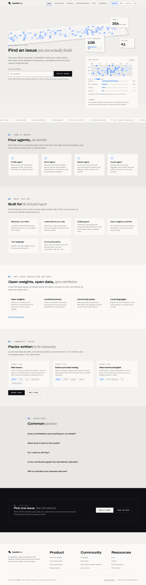
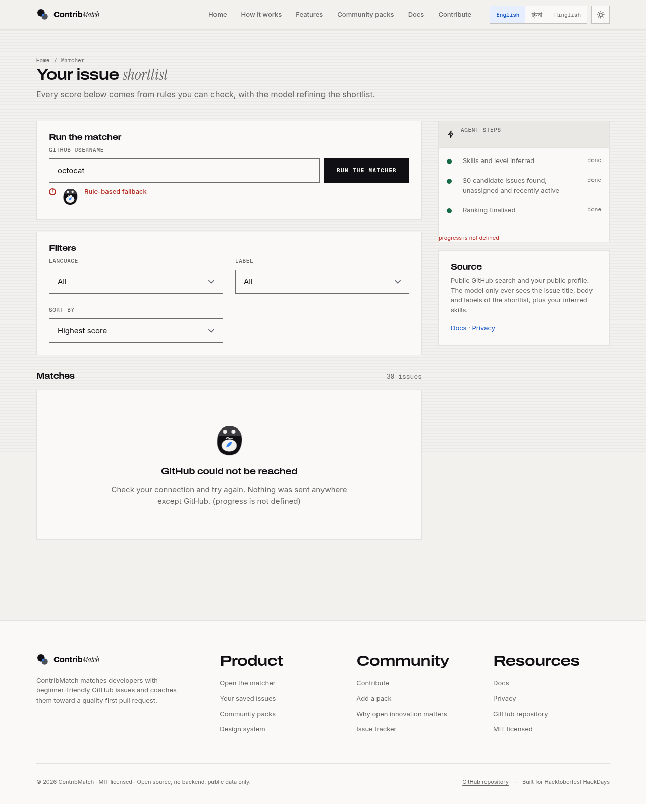
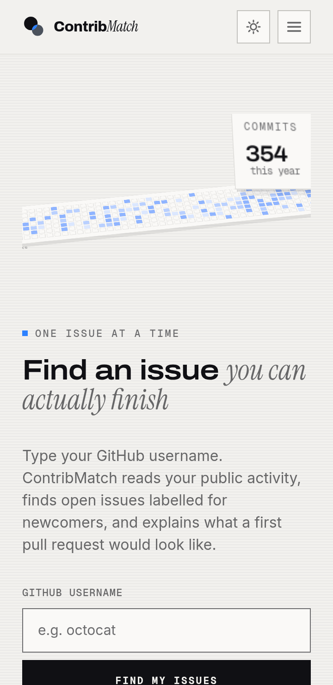
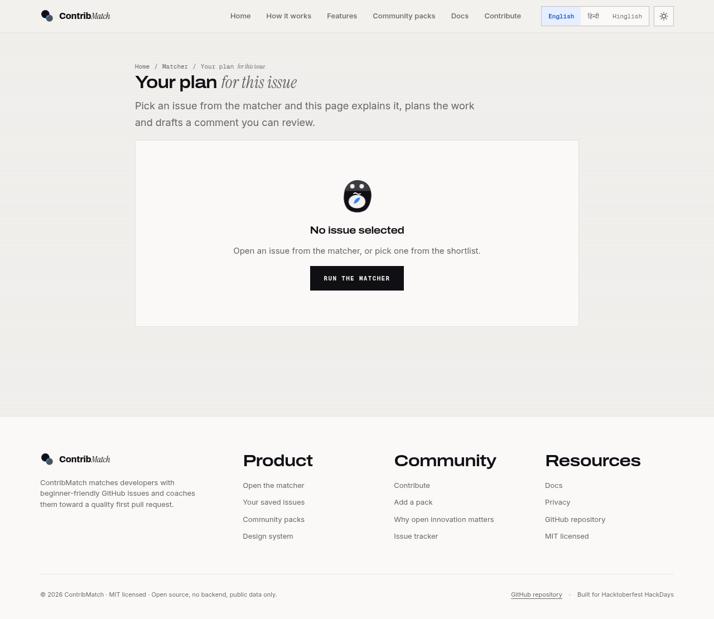
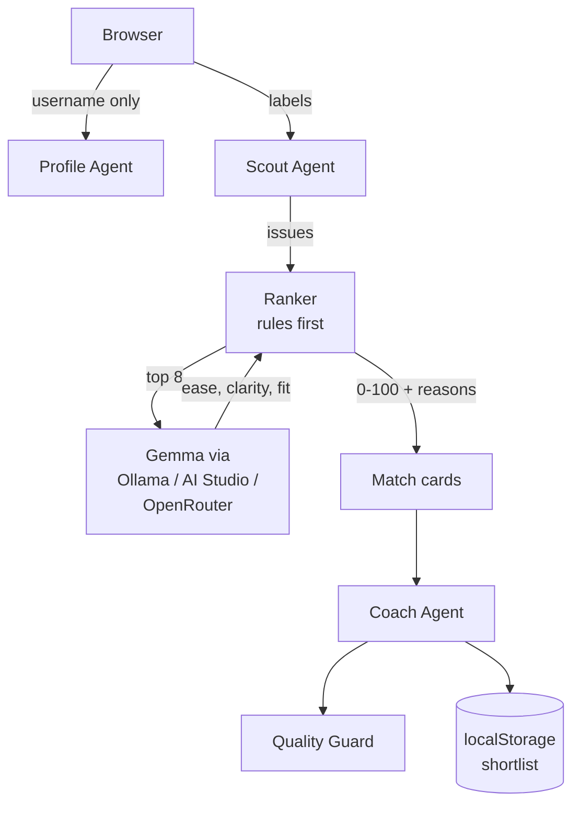

# ContribMatch

**Find an issue you can actually finish.**

ContribMatch matches a developer with a beginner-friendly GitHub issue, then
coaches them through it: what the issue really asks for, which files to open,
what a first plan looks like, and what a quality pull request has to contain.
The scoring is rule-based first, so every number on screen can be checked. An
open-weight Gemma model refines the shortlist and writes the coaching notes.

No backend. No account. No data collection. Everything runs in the browser.

---

## Screenshots

| Home | The matcher |
| --- | --- |
|  |  |

| The contribution graph | A coached issue |
| --- | --- |
|  |  |

More captures, at 360 / 768 / 1280 / 1920 in light and dark, live in
[`docs/screenshots/`](docs/screenshots/).

---

## Why Open Innovation Matters

Open source does not have a shortage of issues. It has a shortage of the first
step: the moment where someone decides "this one is mine" and starts a pull
request that a maintainer can actually merge.

Most of that friction is not about code. It is about not knowing whether an
issue is already taken, whether the project is still alive, whether you are
being asked to do something six months of reading will not prepare you for,
or whether the project even wants the change you are about to propose. New
contributors bounce off that wall and quietly never come back. Experienced
maintainers lose the same hours answering the same questions.

ContribMatch treats that first step as a first-class product problem. It reads
public GitHub data only, and it answers four questions for a newcomer in one
screen:

1. **Is this issue still open and still unclaimed?**
2. **Is it a good first contribution for someone at my level, in a language I
   actually use?**
3. **What exactly do I have to do, and what would a first pull request for it
   look like?**
4. **Is the project healthy enough that my work will not be thrown away?**

Then it gets out of the way. ContribMatch never posts a comment, never opens a
pull request, and never asks for a credential it does not need. The human
writes the code and presses the buttons.

That is the open innovation thesis in one sentence: **the contribution
pipeline is the product, and the product should be owned by the people
building it.** Everything here is MIT licensed, runs from a static file
server, and can be forked into a different community the same afternoon.

---

## What it does

- **Profile Agent** — reads your public repos, languages, topics and activity
  to infer the skills you already have and the level you are at.
- **Scout Agent** — searches GitHub for open, unassigned issues labelled
  `good first issue`, `help wanted` or `hacktoberfest`, filtered to the
  languages you actually use.
- **Ranker** — a transparent 100-point score built from rules you can read:
  language match, repository health, label weight, issue freshness, recent
  activity and body hygiene. Only the top eight issues are sent to the model,
  and the model's rating is blended at 35%, never 100%.
- **Coach Agent** — a plain-language explanation, the likely files, a
  step-by-step first plan, a polite "may I work on this?" comment you can
  copy, and a pull request checklist.
- **Quality Guard** — flags typo-only changes, mass pull requests, and
  contributions that ignore `CONTRIBUTING.md`.
- **Contribution graph** — an exact year from the GraphQL API when a token is
  present, a materialised approximation without one (a full year of public
  issues and pull requests, with commit, review and comment detail from the
  last ~90 days of events), and a clearly labelled sample before you enter a
  name. The graph never pretends an
  approximation is a full year.
- **English, Hindi and Hinglish** — the interface, the coaching notes and the
  comments you copy are all available in three languages.
- **Community packs** — plain JSON or YAML files that describe skills, tone and
  vocabulary for an ecosystem. Add your own.

---

## Architecture



Everything above the dashed line is a plain ES module. Business logic never
touches the DOM: only `js/ui/*` does. That is what makes the Next.js migration
in [`docs/ARCHITECTURE.md`](docs/ARCHITECTURE.md) a port rather than a rewrite.

```
js/core/     agents, ranker, provider, schema, packs, settings, shortlist
js/github/   REST + GraphQL client, cache, normalisation, contributions
js/ui/       every DOM-touching module
packs/       community packs, JSON and YAML
tools/       validation, contrast audit, accessibility audit, screenshots
```

---

## Getting started

There is no build step. Clone and open it.

```bash
git clone https://github.com/Tanmay-Tiwaricyber/contribmatch.git
cd contribmatch
npm install          # only needed for the dev tools (puppeteer, axe-core)
npm run serve        # http://localhost:8080
```

The site is plain HTML, CSS and vanilla ES modules. Any static file server
works — `python3 -m http.server 8080` is enough.

### One command runs everything

```bash
npm test
```

That validates every community pack and then runs the full test suite
(ranking, GitHub parsing, contribution normalisation, level bucketing, pack
validation, provider retry, and the end-to-end orchestrator in mock mode).

Other scripts:

| Command | What it does |
| --- | --- |
| `npm run serve` | Serve the site on port 8080 |
| `npm run validate:packs` | Validate every pack against the schema |
| `npm run refresh:catalogue` | Refresh `data/issues.json` from live GitHub search |
| `npm run a11y` | axe-core + custom checks on all 11 pages, both themes |
| `npm run shots` | Capture every page at 360 / 768 / 1280 / 1920, light + dark |
| `npm run contrast` | Print the measured ratio for every token pair |

---

## Running Gemma, the model behind the matcher

Gemma makes the project tick: after the transparent rule-based ranker scores
every issue, only the top eight are sent to Gemma, which rates each one for
ease, clarity and fit — and that rating is blended at 35% into the final
score. It also writes the plain-language coaching notes. If no model is
available, the app still works fully on rules and says so in a banner.

Four supported ways to run it, all optional and all user-owned:

**Option A — Gemma 3 on your own machine (Ollama, no API key, no data leaves
your computer):**

```bash
ollama pull gemma3:4b     # or gemma3:12b / gemma3:27b, per your hardware
OLLAMA_ORIGINS=http://localhost:8080 ollama serve
```

Open **Docs → Settings** in the site, pick **Ollama** as the provider with the
model `gemma3:4b`, and save. `OLLAMA_ORIGINS` must include the origin the site
is served from — for GitHub Pages that is `https://<user>.github.io`.

**Option B — hosted Gemma via Google AI Studio (no install):**

Create a free key at [aistudio.google.com](https://aistudio.google.com), open
**Docs → Settings**, choose **Google AI Studio** as the provider with the model
`gemma-3-27b-it` (or `gemma-3-12b-it`), and paste the key. It lives in
`sessionStorage` for the tab only and is sent to nothing but Google.

**Option C — hosted Gemma (and many other open models) via OpenRouter
(free tier):**

Create a key at [openrouter.ai/keys](https://openrouter.ai/keys), choose
**OpenRouter** in **Docs → Settings**, and set the model to
`google/gemma-3-27b-it`. `:free` model variants exist, so the full flow can be
judged without any billing — and any other model id OpenRouter hosts works too.

**Option D — ultra-fast hosted inference via Groq:**

Create a key at [console.groq.com](https://console.groq.com), choose **Groq**
in **Docs → Settings**. Groq retired its Gemma models, so its default model is
one of its current open models (`openai/gpt-oss-120b`); any Groq model id
works. Open-weight Gemma remains the core story through Options A–C.

The settings screen confirms which model it reached. There is also **Mock
mode** for a completely offline demo of the whole flow.

### The configuration flow, at a glance

```mermaid
flowchart TD
    S[Open Docs → Settings] --> D{How should the model run?}
    D -->|no key, fastest demo| MM[Mock mode<br/>whole flow offline on sample data]
    D -->|own machine, nothing leaves home| OL[Pick Ollama<br/>ollama pull gemma3:4b<br/>set OLLAMA_ORIGINS to the site origin]
    D -->|hosted, no install| HK{Which key do you have?}
    HK -->|Google AI Studio| GS[Model gemma-3-27b-it<br/>or gemma-3-12b-it]
    HK -->|OpenRouter| ORR[Model google/gemma-3-27b-it<br/>or its :free variant]
    HK -->|Groq| GQ[Model openai/gpt-oss-120b<br/>or any Groq model id]
    OL --> EP[Keep the local endpoint<br/>http://localhost:11434]
    EP --> SV[Save]
    GS --> K[Paste the API key]
    ORR --> K
    GQ --> K
    K --> SV
    MM --> SV
    SV --> STORE[Preferences in localStorage<br/>key in sessionStorage — this tab only, sent only to its provider]
    STORE --> RUN[Run the matcher]
    RUN --> OK{Model reachable?}
    OK -->|yes| AI[Gemma rates the top 8 on ease, clarity, fit<br/>blended at 35% into the rules ranking — coach notes are written]
    OK -->|no| FB[Rule-based fallback banner<br/>the shortlist and the plan are still produced]
    AI --> OUT[Final ranked matches]
    FB --> OUT
```



Every path ends in working matches: the rules rank, the model refines — no
configuration is required to see a complete run.

---

## Settings

Open **Docs → Settings** in the running site, or use the controls in the
sidebar.

| Setting | Where it is stored | Notes |
| --- | --- | --- |
| Theme (light / dark / system) | `localStorage` | Follows `prefers-color-scheme` by default |
| Language | `localStorage` | English, Hindi, Hinglish |
| Mock mode | `localStorage` | Runs the whole flow offline on realistic sample data |
| GitHub token | `sessionStorage` | Read-only, optional, never sent anywhere but GitHub |
| AI Studio / OpenRouter / Groq key | `sessionStorage` | Optional, sent only to the provider it belongs to — never committed, never logged |
| Shortlist | `localStorage` | Exportable as Markdown |

A token is only needed for the exact contribution graph. Without one the app
uses public events, which is approximate and says so. See
[`docs/DEMO.md`](docs/DEMO.md) for the difference, and
[`docs/DEPLOY.md`](docs/DEPLOY.md) for deployment.

---

## Exact data versus approximate data

This distinction is the one that matters most in this project, so it is stated
everywhere it applies.

| Mode | When | What you get | Labelled as |
| --- | --- | --- | --- |
| **Exact** | A GitHub token is present in Settings | The full contribution calendar from the GraphQL API | "Exact" |
| **Approximate** | No token | A full year of your public issues and pull requests (search API), plus commit, review and comment detail from the last ~90 days (events) | "A full year of your public issues and pull requests, with commit and review detail from the last 90 days (approximate). Add a token for the exact calendar." |
| **Sample** | No username entered, or mock mode | Realistic sample data so the page is never empty | "Sample" |

The 3D wall in the hero always covers the same window as the panel next to it.
An approximate graph is never drawn as a full year.

---

## How GitHub requests are managed

Every GitHub request — profile reads, searches, contribution data — goes
through one shared client. The design goal is to make rate-limit errors rare,
recoverable and honest, not impossible.

| Mechanism | What it does |
| --- | --- |
| **Static issue catalogue** | `data/issues.json` is refreshed a few times a day (locally with `npm run refresh:catalogue`, or by `.github/workflows/refresh-catalogue.yml` every 6 h). With a fresh catalogue the matcher makes **zero** live search calls. |
| **Request gate** (`js/github/queue.js`) | One GitHub request in flight at a time, spaced ~600 ms apart; identical in-flight GETs are collapsed; a bounded queue refuses overload with a readable message; failures can never wedge the queue. |
| **Multi-level cache** (`js/github/cache.js`) | In-memory session layer + `localStorage` layer. Search results live 5 minutes, profile/repo metadata 15 minutes. Changing the token in Settings invalidates the cache. |
| **Rate-limit handling** (`js/github/rate-limit.js`) | Primary limits (403/429 with `X-RateLimit-Remaining: 0`) pause the queue until `X-RateLimit-Reset`; secondary limits respect `Retry-After`, otherwise bounded exponential backoff with jitter; transient network failures and 5xx retry at most twice; 401/403-permission/404 never retry. Core REST, Search and GraphQL quotas are tracked separately from response headers. |

What each data source means on the matcher page:

| Result source | When | Label |
| --- | --- | --- |
| `catalogue` | The catalogue is fresh and covers the search | chip shows the last catalogue refresh |
| Live API | The catalogue is stale or has no matches | results come from a cached/queued search |
| `catalogue-stale` | GitHub refused or was unreachable | results are clearly flagged as stale |

If you see *"GitHub rate limit reached"* anyway:

1. Check the chip above the results — it shows what remains of each quota
   bucket and counts down while requests are paused.
2. Without a token the limits are 60 core requests/hour and 10 searches/minute
   per IP; a no-scope token raises these to 5,000/hour and 30 searches/minute.
   Never use a previously leaked or revoked token — create a fresh one.
3. The matcher offers a **Try again** button; the catalogue still serves
   verified data while you wait.

Tokens stay in `sessionStorage` for this browser tab only, are never logged
and never committed. ContribMatch is a static site: browser tokens are
convenient but not a secure way to protect secrets at scale; if you need
centralized authentication, the minimal path is a tiny serverless proxy that
injects its own token server-side and applies the same queue policy.

---

## Adding a community pack

1. Create `packs/my-pack.pack.json` (or `.pack.yaml`).
2. Run `npm run validate:packs`.
3. Add the file to `PACK_FILES` in `js/core/packs.js`.
4. Open a pull request that explains which projects the pack helps with.

The schema is on the [Community packs](packs.html#add) page and in
[`docs/DESIGN_SYSTEM.md`](docs/DESIGN_SYSTEM.md). Five packs ship with the
project: web basics, Python and data tooling, docs and translation, the Go
ecosystem, and plain technical English.

---

## Contributing

Read [`CONTRIBUTING.md`](CONTRIBUTING.md) and pick something from
[`docs/GOOD_FIRST_ISSUES.md`](docs/GOOD_FIRST_ISSUES.md). The
[Code of Conduct](CODE_OF_CONDUCT.md) applies to every space in this project,
and [`SECURITY.md`](SECURITY.md) explains how to report a problem without
opening a public issue.

---

## Deploying

GitHub Pages, straight from the repository: set **Settings → Pages → Source** to
**Deploy from a branch**, branch `main`, folder `/ (root)`. Every link in the
project is relative, so it works under a project subpath such as
`https://<user>.github.io/contribmatch/`. The full checklist is in
[`docs/DEPLOY.md`](docs/DEPLOY.md).

---

## License

MIT. See [`LICENSE`](LICENSE).

The fonts (Archivo, Instrument Serif, Inter, Geist Mono, Noto Sans
Devanagari) are self-hosted under the SIL Open Font License 1.1.

Built for Hacktoberfest HackDays.
